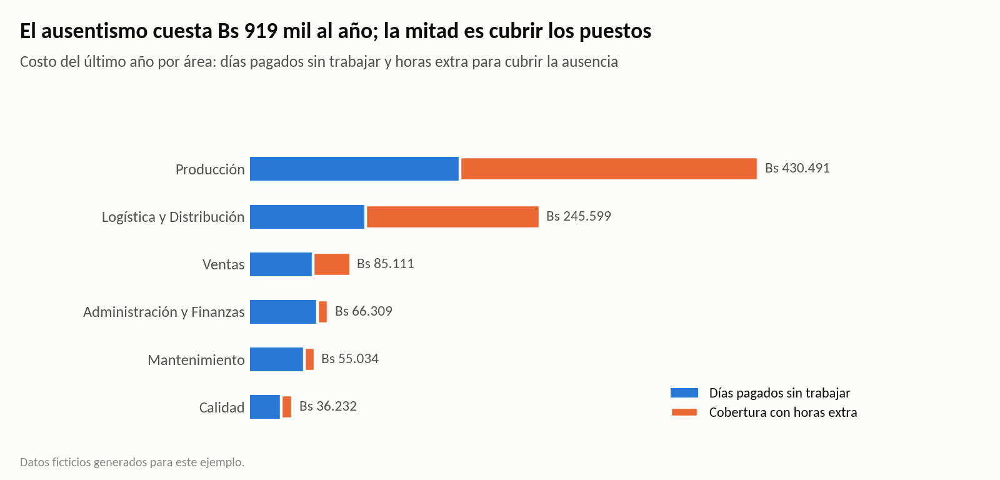
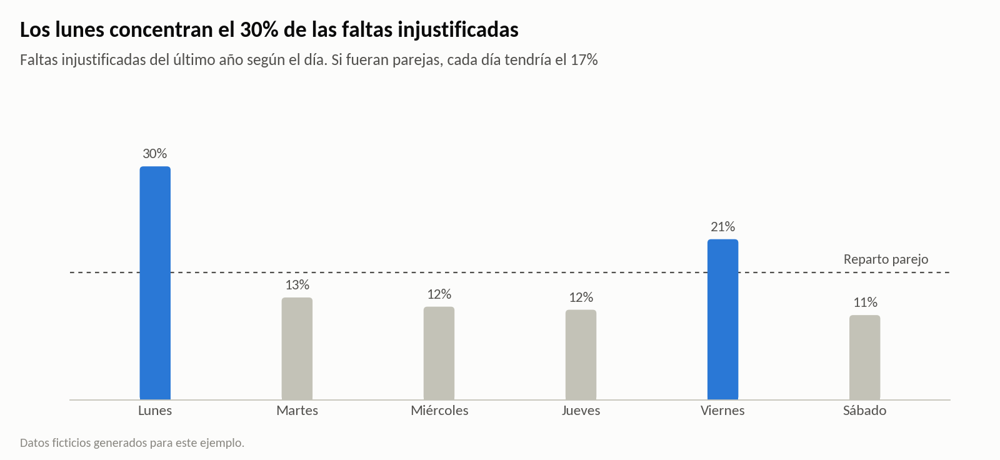
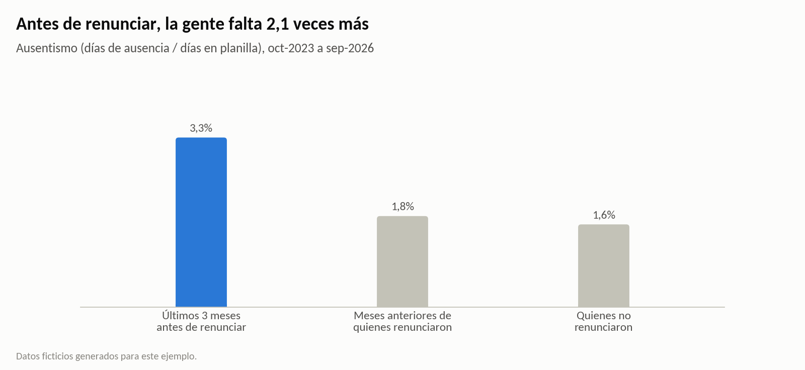
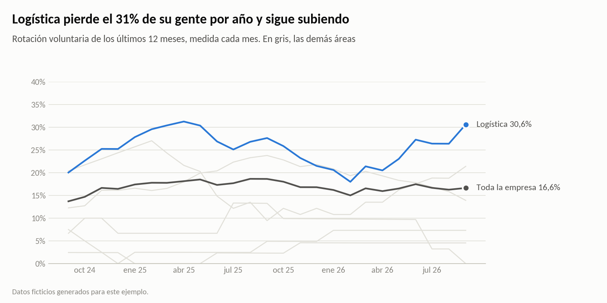
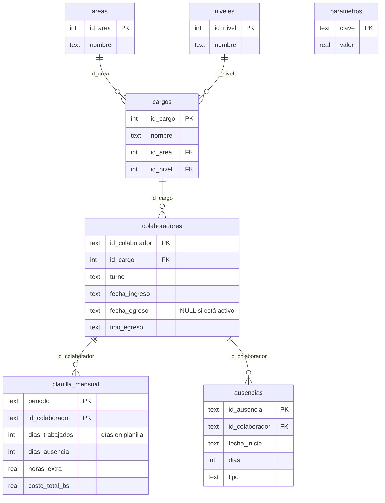

# ¿Cuánto cuesta el ausentismo y qué dicen los indicadores de RRHH?

**Indicadores de RRHH en SQL.** Una base SQLite normalizada con colaboradores, planilla mensual y cada ausencia con su fecha, más 9 consultas que responden preguntas de gestión: dotación, rotación, ausentismo, su costo en bolivianos y alertas de sobrecarga. Las consultas usan CTE, funciones de ventana, agregación condicional y la técnica de huecos e islas.

También tiene una [versión para SQL Server](#versión-sql-server-t-sql): el mismo esquema con tipos `DATE` y `DECIMAL`, las 9 consultas en T-SQL, procedimientos almacenados con parámetros y una vista lista para conectar Power BI.



> **Datos ficticios.** Corresponden a una embotelladora mediana de unos 500 colaboradores, entre octubre de 2023 y septiembre de 2026. Son los mismos datos de los proyectos [Costo de la rotación](https://github.com/karmyvicenteasbun-sys/costo-rotacion-people-analytics) y [Dashboard de costos de personal](https://github.com/karmyvicenteasbun-sys/dashboard-costos-personal-powerbi), más el detalle de las 8.549 ausencias. No describen a ninguna empresa real.

## Resultados (último año: oct-2025 a sep-2026)

| Pregunta | Respuesta |
|---|---|
| ¿Cuánto cuesta el ausentismo? | **Bs 918.776 al año.** La mitad son días pagados sin trabajar y la otra mitad, **horas extra al doble para cubrir los puestos**. Producción y Logística suman el **74%** del costo. |
| ¿Hay un patrón? | Los **lunes** concentran el **30%** de las faltas injustificadas y los viernes el 21%; si fueran parejas, cada día tendría el 17%. El turno rotativo falta 22% más que el diurno (1,9% contra 1,5%). |
| ¿Está concentrado en pocas personas? | El 20% de las personas con mayor factor de Bradford (ausencias cortas y repetidas) acumula el **41%** de los días de ausencia. |
| ¿Avisa algo? | Sí. En los **3 meses antes de renunciar**, la gente falta **2,1 veces más** (3,3% contra 1,6%) y más de la mitad de esas ausencias son faltas injustificadas. |
| ¿Y la rotación? | La rotación voluntaria de la empresa es **16,6%**, pero **Logística pierde el 31%** de su gente por año y viene subiendo desde febrero. El 49% de las renuncias ocurre antes del primer año. |
| ¿Qué hacer primero? | **Usar el ausentismo como alerta temprana**: una conversación de retorno después de cada falta injustificada (sobre todo los lunes) y seguimiento cuando alguien falta más de lo habitual. Además, revisar a las **35 personas** que hicieron más de 40 horas extra al mes durante 3 meses seguidos o más, casi todas en Logística y Producción. |

## Las consultas

| Archivo | Pregunta | Técnicas |
|---|---|---|
| `01_dotacion_y_movimientos.sql` | ¿Cuántas personas hay cada mes y cuántas entran y salen? | CTE, agregación condicional, `LAG()` |
| `02_rotacion_movil_12_meses.sql` | ¿La rotación sube o baja, y en qué áreas? | Ventanas con marco `ROWS BETWEEN 11 PRECEDING`, cláusula `WINDOW` |
| `03_rotacion_por_antiguedad.sql` | ¿En qué momento se va la gente? | Tramos con `VALUES`, `JOIN` por rangos, tasa por meses-persona |
| `04_ausentismo_por_area.sql` | ¿Qué áreas y turnos faltan más? | `SUM(CASE ...)`, `UNION ALL` para el total |
| `05_faltas_por_dia_de_semana.sql` | ¿Las faltas se concentran en algún día? | `strftime('%w')`, `SUM() OVER ()` |
| `06_factor_bradford.sql` | ¿Dónde se concentran los días de ausencia? | `NTILE()`, `LEFT JOIN` para incluir a quien no faltó |
| `07_costo_ausentismo.sql` | ¿Cuánto cuesta el ausentismo? | Parámetros en una tabla, `CROSS JOIN`, pivote con `MAX(CASE ...)` |
| `08_alerta_horas_extra.sql` | ¿Quién tiene sobrecarga de horas extra varios meses seguidos? | Huecos e islas con `ROW_NUMBER()` |
| `09_ausencias_antes_de_renunciar.sql` | ¿Las ausencias avisan una renuncia? | Aritmética de meses, clasificación con `CASE` |

Los resultados completos están en `resultados/`, un CSV por consulta.

### Un ejemplo: rachas de sobrecarga con huecos e islas

Si a un número de mes correlativo se le resta `ROW_NUMBER()`, los meses consecutivos de una persona dan el mismo valor y forman una misma racha:

```sql
WITH meses_altos AS (
    SELECT id_colaborador, periodo, horas_extra,
           CAST(substr(periodo, 1, 4) AS INTEGER) * 12
         + CAST(substr(periodo, 6, 2) AS INTEGER) AS mes_correlativo
    FROM planilla_mensual
    WHERE horas_extra > 40 AND periodo >= '2025-10'
),
islas AS (
    SELECT *, mes_correlativo
              - ROW_NUMBER() OVER (PARTITION BY id_colaborador ORDER BY mes_correlativo) AS isla
    FROM meses_altos
)
SELECT id_colaborador, MIN(periodo) AS desde, MAX(periodo) AS hasta, COUNT(*) AS meses_seguidos
FROM islas
GROUP BY id_colaborador, isla
HAVING COUNT(*) >= 3;
```

| id_colaborador | área | cargo | desde | hasta | meses seguidos | horas extra promedio |
|---|---|---|---|---|---:|---:|
| C0085 | Logística y Distribución | Ayudante de reparto | 2025-10 | 2026-09 | 12 | 58,0 |
| C0686 | Logística y Distribución | Auxiliar de almacén | 2025-10 | 2026-05 | 8 | 55,1 |
| C0403 | Producción | Auxiliar de producción | 2025-10 | 2026-04 | 7 | 57,6 |

### Costo del ausentismo por área

| Área | Días de ausencia | Días pagados sin trabajar (Bs) | Cobertura con horas extra (Bs) | Total (Bs) |
|---|---:|---:|---:|---:|
| Producción | 1.269 | 178.081 | 252.411 | 430.491 |
| Logística y Distribución | 694 | 98.147 | 147.451 | 245.599 |
| Ventas | 364 | 53.579 | 31.531 | 85.111 |
| Administración y Finanzas | 242 | 57.204 | 9.105 | 66.309 |
| Mantenimiento | 241 | 45.924 | 9.110 | 55.034 |
| Calidad | 173 | 26.666 | 9.566 | 36.232 |

Supuestos, guardados en la tabla `parametros` y editables:
- Los días de enfermedad y los permisos se pagan completos, con la carga patronal: aportes de 16,71% y provisiones de aguinaldo e indemnización.
- Las faltas injustificadas se descuentan del sueldo.
- En Producción y Logística se cubre con horas extra al doble el 70% de los días de ausencia de los operativos; en las demás áreas, el 30%.

| | |
|---|---|
|  |  |



## El modelo de datos



El esquema (`sql/00_esquema.sql`) tiene claves foráneas, restricciones `CHECK` e índices, más la vista `v_colaboradores`, que junta a cada persona con su cargo, área y nivel. Al crear la base, `crear_base.py` controla que los días de ausencia del detalle coincidan con los de la planilla en cada mes.

## Estructura

```
├── sql/00_esquema.sql          tablas, restricciones, índices y vista
├── consultas/                  las 9 consultas, comentadas
├── sql_server/                 versión T-SQL: esquema, carga, procedimientos, 9 consultas y prueba
├── crear_base.py               crea rrhh.db a partir de los CSV y controla la integridad
├── ejecutar_consultas.py       corre las consultas, guarda los resultados y arma los gráficos
├── generar_datos.py            genera colaboradores y planilla (semilla fija)
├── generar_ausencias.py        reparte los días de ausencia de la planilla en episodios con fecha
├── graficos.py                 estilo de los gráficos
├── requirements.txt
├── datos/                      colaboradores.csv, planilla_mensual.csv, ausencias.csv
├── resultados/                 un CSV por consulta
└── img/                        gráficos
```

## Cómo correrlo

```bash
pip install -r requirements.txt
python ejecutar_consultas.py     # crea rrhh.db si no existe y corre las 9 consultas
```

Las consultas también se pueden abrir y ejecutar en DB Browser for SQLite o DBeaver, sobre `rrhh.db`. Necesitan SQLite 3.28 o superior, que ya viene con Python 3.8 en adelante.

## Versión SQL Server (T-SQL)

La carpeta `sql_server/` tiene la misma base y las mismas 9 consultas escritas para SQL Server 2017 o superior.

| Archivo | Qué hace |
|---|---|
| `00_esquema.sql` | Tablas con tipos `DATE`, `DECIMAL` y `NVARCHAR`, claves foráneas, restricciones `CHECK` con nombre, índices con `INCLUDE` y la vista `v_colaboradores`. |
| `01_cargar_datos.sql` | Carga los CSV con `BULK INSERT` a tablas temporales, normaliza áreas, niveles y cargos, convierte tipos con `TRY_CONVERT` y controla la integridad dentro de una transacción: si algo no cuadra, hace `ROLLBACK` y no carga nada. |
| `02_procedimientos.sql` | `usp_costo_ausentismo` (costo para cualquier rango de fechas), `usp_alerta_horas_extra` (umbral y meses mínimos como parámetros), `usp_validar_integridad` (5 controles de calidad) y la vista `v_ausentismo_mensual`, pensada como origen de un modelo en Power BI. |
| `consultas/` | Las 9 consultas en T-SQL, con los mismos nombres que en SQLite. |
| `probar_sql_server.py` | Arma la base desde Python con `pyodbc`, corre las 9 consultas y las compara con `resultados/`. |

Qué cambia respecto de SQLite:

| SQLite | SQL Server |
|---|---|
| `strftime('%Y-%m', fecha)` | `CONVERT(CHAR(7), fecha, 126)` |
| `julianday(b) - julianday(a)` | `DATEDIFF(DAY, a, b)` |
| `strftime('%w', fecha)` | `DATEDIFF(DAY, '19000101', fecha) % 7 + 1`, que no depende de `SET DATEFIRST` ni del idioma del servidor |
| `SUM(condición)` | `SUM(CASE WHEN condición THEN 1 ELSE 0 END)` |
| `WITH t (a, b) AS (VALUES ...)` | `SELECT ... FROM (VALUES ...) AS t (a, b)` |
| `MAX(x, 0)` en una fila | `CASE` dentro de un `CROSS APPLY` |
| Cláusula `WINDOW` | Ventana repetida (`WINDOW` recién existe desde SQL Server 2022) |
| `AVG()` de enteros da decimales | `AVG(1.0 * x)`, porque en SQL Server `AVG()` de un entero devuelve un entero |

Ejemplo de uso de los procedimientos:

```sql
EXEC dbo.usp_costo_ausentismo @desde = '20260101', @hasta = '20260630';   -- primer semestre de 2026
EXEC dbo.usp_alerta_horas_extra @desde = '20251001', @umbral = 50, @meses_minimos = 2;
EXEC dbo.usp_validar_integridad;
```

Para probarla en un SQL Server, sobre una base vacía (`CREATE DATABASE rrhh`):

```bash
pip install pyodbc
python sql_server/probar_sql_server.py "DRIVER={ODBC Driver 18 for SQL Server};SERVER=localhost;DATABASE=rrhh;Trusted_Connection=yes;TrustServerCertificate=yes"
```

**Cómo se verificó.** Las 9 consultas T-SQL se tradujeron a DuckDB con [sqlglot](https://github.com/tobymao/sqlglot) y se corrieron sobre los mismos datos: dan exactamente los mismos resultados que la versión SQLite, fila por fila. `probar_sql_server.py` hace la misma comparación contra un SQL Server real.

**Un hallazgo de calidad de datos.** El control de ausencias superpuestas de `usp_validar_integridad` encuentra 2 casos entre las 8.549 ausencias: la misma persona tiene registrados dos episodios en fechas que se pisan (por ejemplo, una baja médica del 9 al 11 y una falta el día 10). Afectan 2 días en 3 años, así que no cambian los resultados; con datos reales, se corregirían en el sistema de origen.

## Límites

- El costo es una estimación con supuestos simples. En la práctica, la seguridad social cubre parte de las bajas médicas largas, y eso hay que descontarlo con datos reales.
- El factor de Bradford sirve para ordenar las conversaciones, no para sancionar: detrás de muchas ausencias cortas puede haber una enfermedad o un problema familiar.
- Las consultas de `consultas/` usan funciones de fecha de SQLite; las de `sql_server/consultas/` son la versión para SQL Server. Para PostgreSQL habría que adaptar las fechas otra vez.

**Herramientas:** SQL (SQLite y SQL Server / T-SQL) · Python · pandas · matplotlib

---

### English summary

This is an HR analytics project in SQL on a fictional bottling company with about 500 employees and synthetic data from October 2023 to September 2026.
- The SQLite database is normalized, with constraints, indexes and a view. Nine commented queries cover headcount, rolling 12-month turnover, tenure-based turnover rates, absenteeism, the Bradford factor, the cost of absence and overtime-overload streaks.
- The queries use CTEs, window functions and gaps-and-islands.
- A SQL Server (T-SQL) version adds typed tables, a transactional bulk load with integrity checks, parameterized stored procedures and a view ready for Power BI. Its nine queries return exactly the same results as the SQLite version.

Key findings: absence costs about Bs 0.92 million a year, and half of that is overtime to cover the missing person. Unjustified absences cluster on Mondays. People are absent 2.1 times more often in the three months before they resign.

---

Vicente Asbun · [LinkedIn](https://www.linkedin.com/in/vicente-antonio-asbun-karmy-30aa19164/)
